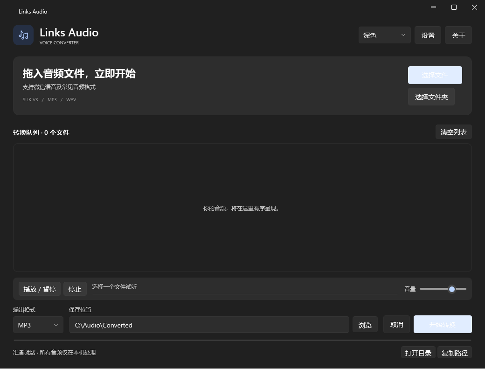
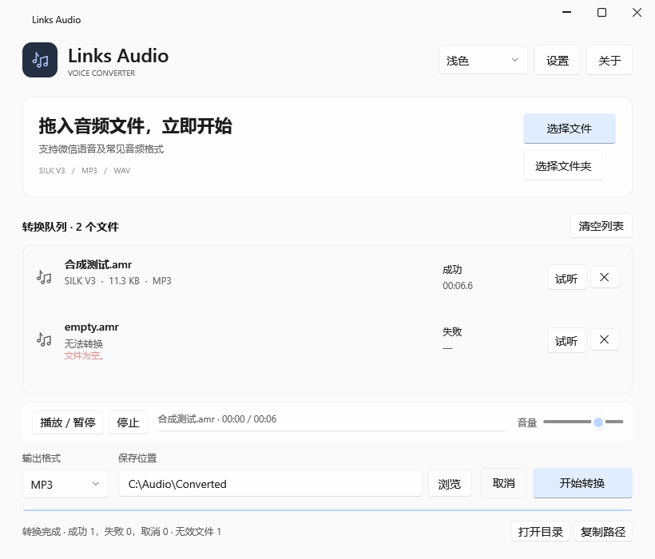
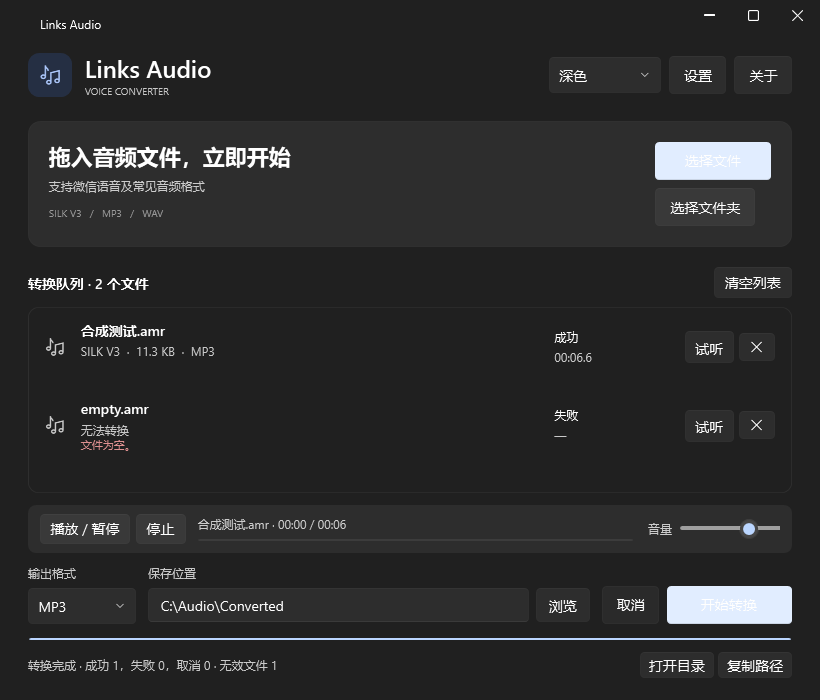
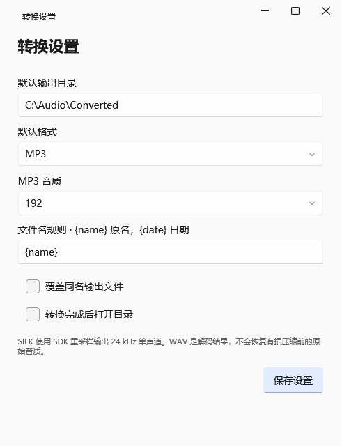
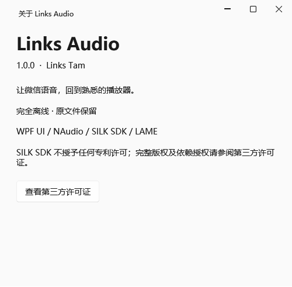

# Links Audio

**Modern Offline Audio Converter for Windows**

让语音文件，回到熟悉的播放器。

Links Audio 是一款面向 Windows 的离线音频转换工具。拖入 SILK 语音、MP3 或 WAV，选择格式与目录，即可在本机完成转换。无需命令行、账号或额外安装运行环境。

[English](README_EN.md) · [构建说明](BUILD.md) · [测试范围](TEST_REPORT.md) · [第三方许可](THIRD_PARTY_NOTICES.md)


**本地转换 · 批量处理 · MP3 / WAV · 深浅主题**

## 界面一览

从导入到保存，常用操作集中在同一个窗口。下面均为实际应用截图，使用无语音合成样本和通用路径。

<table>
<tr><td width="50%" align="center"><strong>拖入文件，开始转换</strong><br></td><td width="50%" align="center"><strong>浅色模式，同样清晰</strong><br></td></tr>
</table>

文件夹导入、任务状态、试听入口和输出操作都在主窗口中；窗口缩小时，队列仍保持可用。

<details>
<summary><strong>查看紧凑窗口</strong></summary>



</details>

### 保留必要的设置

输出目录、MP3 码率、命名规则与同名处理集中在设置中。关于窗口列出版本、作者和第三方许可入口。

<table>
<tr><td width="50%" align="center"><strong>转换设置</strong><br></td><td width="50%" align="center"><strong>关于 Links Audio</strong><br></td></tr>
</table>

## 功能

- 识别标准 SILK V3 和微信 Tencent `0x02` 前缀；文件扩展名只作辅助参考。
- SILK → MP3 / WAV；MP3、常见 PCM WAV 也可作为输入。
- 多文件导入、文件夹导入、后台批量转换、移除任务与取消。
- 播放、暂停、停止、音量和播放进度。
- 深色、浅色与跟随系统主题；界面使用 WPF UI。
- 同名文件自动编号，可选覆盖；始终保留输入原件。
- 转换结果经过完整解码读取及持续时间检查，再提交输出。

日常使用不需要网络、账号或登录；不上传音频，也没有云端处理接口。

## 下载

在本仓库右侧的 **Releases** 页面下载 **`LinksAudio-Portable-win-x64.zip`**，完整解压后即可使用。

GitHub 自动提供的 **Source code (zip)** 是源码快照，不是 Windows 程序。普通用户应下载名称含 **Portable-win-x64** 的附件。

1. 完整解压便携 ZIP。
2. 双击 `LinksAudio.exe`，保留旁边的两个 DLL 和许可证目录。
3. 拖入文件，或点击「选择文件」「选择文件夹」。
4. 选择 MP3 / WAV 和保存位置，点击「开始转换」。
5. 完成后试听或打开输出目录。

无需安装 Node.js、npm、Python、.NET Runtime 或 FFmpeg。

## 支持格式

| 输入内容 | 输出 | 状态 | 说明 |
|---|---|---|---|
| SILK V3 标准容器 | MP3 / WAV | 支持 | `#!SILK_V3` 文件头 |
| Tencent 前缀 SILK | MP3 / WAV | 支持 | 微信常见变体；`.amr`、`.aud`、`.slk` 等后缀不会改变内容检测 |
| MP3 | MP3 / WAV | 支持 | 使用 NLayer 解码 |
| 常见 PCM / IEEE float WAV | MP3 / WAV | 支持 | 其他压缩 WAV 取决于系统解码能力 |
| 真正 AMR-NB / AMR-WB | — | 暂不支持解码 | 能正确识别并明确报错，不能当成 SILK |
| 其他容器 | — | 未支持 | 不提供 FLAC / M4A 输出 |

SILK 默认请求 SDK 输出 24 kHz、16 bit 单声道 PCM；这不是对源录音采样率的猜测。转 WAV 不会恢复有损压缩前的音质。为保护内存，SILK 输入限制为 128 MB。

## 系统与验证范围

构建目标为 Windows 10/11 **x64**。本机 Windows 11 x64 的发布版已经启动、转换和试听；尚未分别验证干净 Windows 10、Windows N、Server 或 ARM64。

本次公开准备使用无语音合成样本，26 项引擎测试通过。GUI 导入、队列转换、试听、主题切换和 LAME 备用编码均已执行。真实微信/QQ 录音兼容性、人工听音和实际跨屏 DPI 切换仍待进一步验证；因此初次公开时建议标记为 **Pre-release**。完整限制见 [测试报告](TEST_REPORT.md)。

## 设置与隐私

JSON 配置优先保存在程序旁 `config/settings.json`；程序目录不可写时回退至用户的 LocalApplicationData。配置损坏不会阻止启动。设置包括目录、格式、码率、命名规则、同名处理和完成后打开目录。

音频只在本机读取、解码和保存。试听 SILK 时会创建临时 WAV。正常取消、转换失败和退出时会尽力清理临时文件；异常终止或断电可能留下缓存。公开仓库只包含数学合成测试音调，不包含聊天录音、个人设置或本地日志。

## 开发

开发者需要 Windows x64 和 .NET SDK 10.0.402（或 global.json 允许的更高兼容 SDK）；可选 Zig 0.13.0 用于重建原生库。

```powershell
./build/build.ps1
./build/test.ps1
```

详见 [BUILD.md](BUILD.md)。构建时会连接 NuGet 恢复依赖；软件日常运行完全离线。调整界面请修改 `src/LinksAudio.App/MainWindow.xaml`；音频引擎在 `src/LinksAudio.Core/AudioEngine.cs`。新增编码格式应通过音频层扩展。

## License & Credits

Links Audio 自有 C#/XAML、图标和构建辅助代码采用 [MIT](LICENSE)，作者 **Links Tam**。这不代表所有依赖都使用 MIT：

- WPF UI、NAudio、NLayer、NAudio.Lame：MIT。
- SILK SDK：Skype 自有 BSD 风格许可，明确不授予专利许可。
- LAME 3.100：LGPL 2.0 或更新版本，作为可替换 DLL 分发；随包提供对应源码与构建配置。

见 [第三方声明](THIRD_PARTY_NOTICES.md)、[许可审查](docs/LICENSE_AUDIT.md) 与 `licenses/`。没有使用或分发 FFmpeg、pilk 或 Python 运行时。
