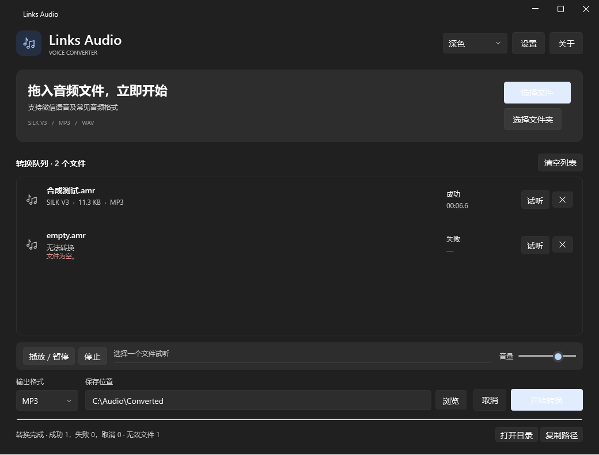

# Links Audio

**Modern Offline Audio Converter for Windows**

A local Windows audio converter for SILK V3 voice files, with MP3/WAV output, a batch queue and basic playback. File contents determine the format, rather than the extension.

[简体中文](README.md) · [Build](BUILD.md) · [Test scope](TEST_REPORT.md) · [Third-party notices](THIRD_PARTY_NOTICES.md)



This is the running application with generated tones, not a design mockup. The output field shows a generic example path. No recorded speech is included.

## Features

- Standard `#!SILK_V3` and Tencent `0x02` container detection.
- SILK, MP3 and common PCM/float WAV inputs; MP3 and WAV outputs.
- File/folder import, background batch conversion, removal and cancellation.
- Play/pause/stop, volume and playback progress.
- Dark, light and system themes using WPF UI.
- Automatic filename numbering, optional overwrite and input preservation.
- Full output decoding and duration checks before committing a result.

True AMR-NB/WB is recognized but **not decoded**. Other containers and FLAC/M4A output are not supported. Compressed WAV support depends on installed system decoders.

## Download and use

Download `LinksAudio-Portable-win-x64.zip` from this repository's **Releases** page when published. No repository or release URL has been invented here. GitHub's automatic **Source code (zip)** is a source snapshot, not the desktop application.

1. Extract the whole portable ZIP.
2. Run `LinksAudio.exe`; keep both native DLLs and the license folder beside it.
3. Add files or a folder.
4. Choose MP3/WAV and an output folder, then start conversion.
5. Play the result or open the output folder.

No Node.js, npm, Python, .NET Runtime or FFmpeg installation is required for normal use.

## Requirements and validation

The build targets **Windows 10/11 x64**. The release has been started and exercised on the current Windows 11 x64 machine. Clean Windows 10, Windows N, Server and ARM64 environments have not been individually verified.

This publication pass runs 26 engine checks using generated non-speech tones. GUI conversion, playback, theme switching and forced LAME encoding have also been exercised. Real-world WeChat/QQ recordings, subjective listening and actual cross-monitor DPI transitions remain unverified in this pass. Marking the initial release as a **Pre-release** is recommended. See [TEST_REPORT.md](TEST_REPORT.md).

The SILK SDK is asked for 24 kHz, 16-bit mono output. This is an output rate, not an inferred recording rate. WAV output does not restore information lost during compression. SILK inputs are limited to 128 MB as a memory safeguard.

## Privacy

The application has no login, upload or cloud-processing interface. Audio stays local. SILK preview creates a temporary WAV; normal exit, cancellation and failures attempt cleanup. An abrupt termination may leave temporary files.

Settings are stored beside the application when writable, falling back to LocalApplicationData. This repository contains only generated audio fixtures, never personal recordings or user settings.

## Development

Use Windows x64 and .NET SDK 10.0.402 or a compatible later SDK allowed by `global.json`. Zig 0.13.0 is optional for native rebuilds.

```powershell
./build/build.ps1
./build/test.ps1
```

Build-time package restore requires NuGet access. The desktop app runs offline. See [BUILD.md](BUILD.md) and [CONTRIBUTING.md](CONTRIBUTING.md).

## License and author

**Links Tam**. Project-owned code/assets are MIT licensed. Dependencies retain their own terms: WPF UI, NAudio, NLayer and NAudio.Lame use MIT; the SILK SDK has its Skype BSD-style license with no patent grant; LAME 3.100 is LGPL 2.0-or-later and is distributed as a replaceable DLL with corresponding source and build configuration.

See [LICENSE](LICENSE), [THIRD_PARTY_NOTICES.md](THIRD_PARTY_NOTICES.md) and [license review](docs/LICENSE_AUDIT.md). FFmpeg, pilk and Python runtimes are not used or distributed.
